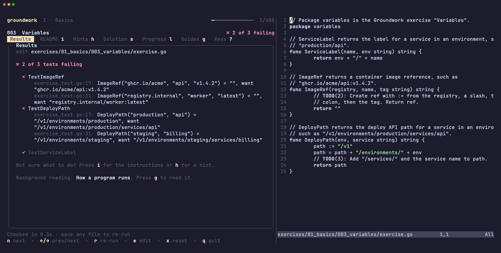
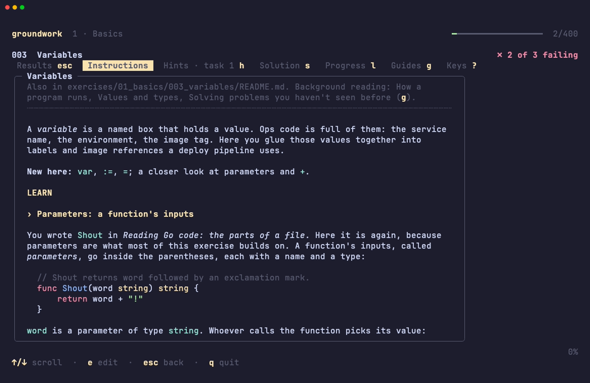
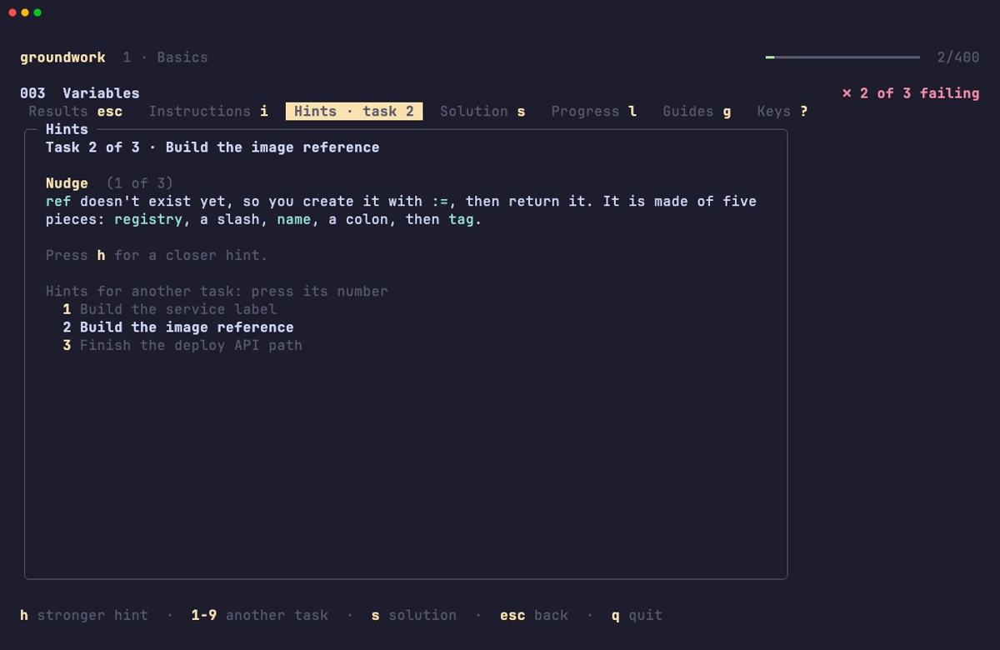
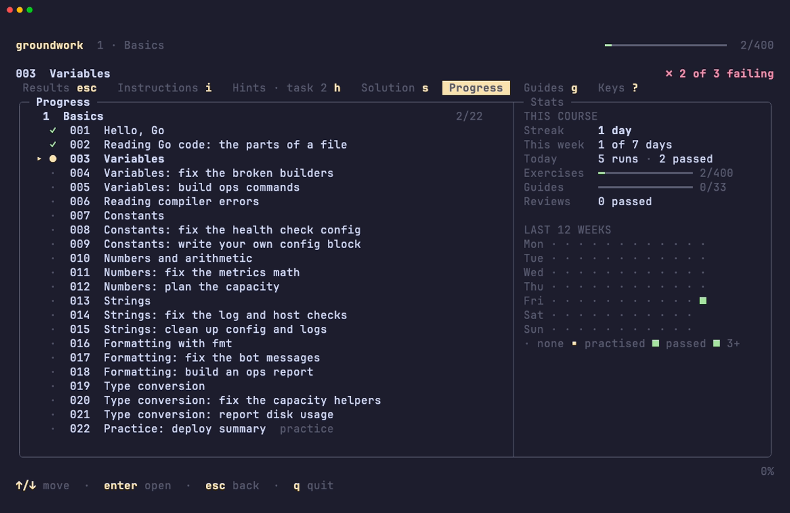
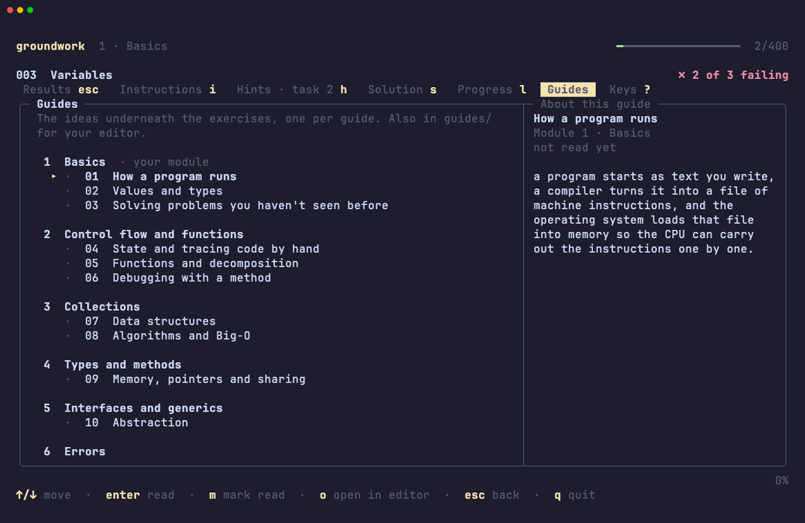

# Groundwork

**Learn Go by fixing small programs until their tests pass, in your terminal.**



400 exercises take you from your first line of code to the Go that DevOps and
platform engineers write every day: CLIs, HTTP services, concurrency,
Kubernetes controllers and AWS automation. The shell, Git, SQL, Docker and CI
come along the way.

## Get started

Needs Go 1.26 or newer, git and bash.

```bash
go install github.com/brzrkr-io/groundwork@latest
groundwork init ~/groundwork
groundwork
```

New to Go, or want the recommended layout? Follow the **[setup guide](SETUP.md)**.

## How it works

1. Groundwork shows the exercise and its failing tests.
2. You fix the `TODO`s in your editor and save.
3. The tests re-run on every save and show what's still wrong.
4. Stuck? `h` gives a hint. Passed? `n` opens the next exercise.

| | |
|:---:|:---:|
|  |  |
| **Instructions** (`i`): a worked example, then your task | **Hints** (`h`): a nudge, then closer, then the answer |
|  |  |
| **Progress** (`l`): streak, activity and every exercise | **Guides** (`g`): the computer science underneath |

## What's in it

| Phase | What you learn |
|---|---|
| Go foundations | Types, functions, collections, interfaces, generics, errors, testing |
| Everyday tools | The shell and Git |
| Practical Go | Text and JSON, SQL, CLI tools, packages, engineering practice |
| Building services | HTTP, concurrency, production services, containers and CI/CD, system design |
| Platform engineering | Kubernetes, client-go controllers, AWS fundamentals, the AWS SDK |
| Capstones | Ship a service to Kubernetes with CI; build a manifest policy checker |

**400 exercises · 24 modules · 33 guides · about 186 hours.** The tests run
on your machine with no database, Docker, cluster or AWS account. Practice
exercises come back for review 2, 7 and 30 days after you pass them, and
`groundwork cards` turns the guides into Anki flashcards.

[Full syllabus](LESSON_PLAN.md) · [How to study with it](LEARNING.md) · Press `?` in the app for every key

## Contributing

```bash
git clone https://github.com/brzrkr-io/groundwork && cd groundwork
go install .
go test -short ./...
```

Exercises live in `content/packs/` and guides in `content/guides/`.
[content/AUTHORING.md](content/AUTHORING.md) explains the format.
