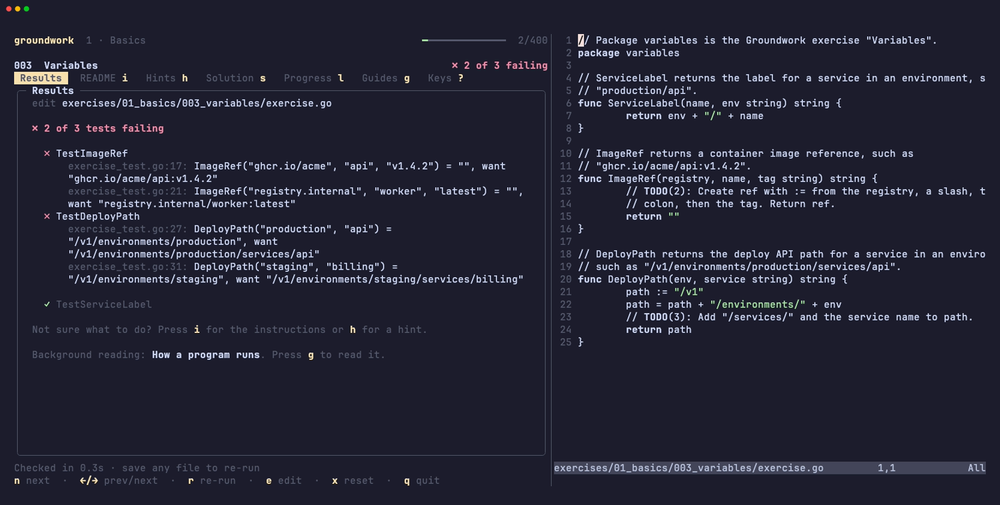

# Setup guide

Groundwork runs on macOS and Linux. On Windows, use
[WSL](https://learn.microsoft.com/windows/wsl/install) and follow the Linux
steps.

## 1. Install Go

You need **Go 1.26 or newer**.

- **macOS:** `brew install go`, or the installer from [go.dev/dl](https://go.dev/dl/).
- **Linux:** the archive from [go.dev/dl](https://go.dev/dl/), installed the way
  [go.dev/doc/install](https://go.dev/doc/install) describes. Distribution
  packages are often too old.

```bash
go version    # go1.26 or newer
```

You also need **git** and **bash**: `git --version` and `bash --version` should
both work. On macOS, `xcode-select --install` adds git if it's missing.

## 2. Install Groundwork

```bash
go install github.com/brzrkr-io/groundwork@latest
groundwork version
```

Go puts programs in `~/go/bin`. If you get *command not found*, add that folder
to your PATH, then open a new terminal:

```bash
echo 'export PATH="$PATH:$HOME/go/bin"' >> ~/.zshrc     # macOS (zsh)
echo 'export PATH="$PATH:$HOME/go/bin"' >> ~/.bashrc    # Linux (bash)
```

## 3. Create your course folder

```bash
groundwork init ~/groundwork
```

This is where your work lives. From now on, `groundwork` finds it from any
folder.

```text
~/groundwork/
├── exercises/      every exercise, numbered in order
├── solutions/      reference solutions, added as you unlock them
├── guides/         the guides, as Markdown
└── .groundwork/    your progress
```

Nothing backs this folder up. To keep your work safe, put it in git.

## 4. Set up your editor

Any editor works. Two things make it better:

- **Go support**, so mistakes show up as you type: the
  [Go extension](https://marketplace.visualstudio.com/items?itemName=golang.go)
  for VS Code, GoLand, or [gopls](https://go.dev/gopls/) in Neovim, Vim,
  Emacs or Zed.
- **`$EDITOR`**, if you use a terminal editor. With `export EDITOR=nvim` (or
  `vim`, `nano`) in your shell config, pressing `e` opens the exercise and
  brings you back to Groundwork when you quit.

## 5. Run it side by side

Run Groundwork on one side and your editor on the other:



- **Left:** a terminal running `groundwork`.
- **Right:** your editor with `~/groundwork/exercises` open, for example
  `code ~/groundwork/exercises` or `nvim ~/groundwork/exercises`.

Two windows side by side work, and so does a split in tmux, Ghostty, iTerm2,
WezTerm or VS Code's built-in terminal. Give Groundwork about 100 columns or
more and it adds a sidebar with the tasks, hints and what to read next.

## 6. Do your first exercise

1. Groundwork opens **001 Hello, Go**. Both tests fail; that's the starting
   point.
2. Press `i` and read the instructions.
3. Open `exercises/01_basics/001_hello_go/exercise.go`, fix the lines marked
   `TODO`, and save.
4. The tests re-run as soon as you save. When they pass, press `n` for the
   next exercise.

Stuck? `h` shows a hint, and pressing it again gives a stronger one. `?` lists
every key.

## Keep it up to date

```bash
go install github.com/brzrkr-io/groundwork@latest
```

New and changed exercises show up the next time you start Groundwork. Files
you've edited are never overwritten.

## Optional tools

Some exercises end with a *Run it for real* section that tries the same thing
on real infrastructure. The tests never need these.

| To try it on | Install |
|---|---|
| Containers | [Docker](https://docs.docker.com/get-docker/) |
| Kubernetes | [kind](https://kind.sigs.k8s.io/) and [kubectl](https://kubernetes.io/docs/tasks/tools/) |
| AWS | the [AWS CLI](https://aws.amazon.com/cli/) and an AWS account |

## Troubleshooting

| Problem | Fix |
|---|---|
| `groundwork: command not found` | Add `~/go/bin` to your PATH (step 2) |
| "there's no Groundwork course in this directory or its parents" | Run `groundwork init ~/groundwork`, or set `GROUNDWORK_COURSE` to your course folder |
| "the exercises need Go 1.26 or newer" | Update Go (step 1) |
| "this course folder was set up by a newer groundwork" | Update Groundwork (see *Keep it up to date*) |
| `e` asks you to set `$EDITOR` | Set it in your shell config (step 4) |
| A file you edited didn't change when the course updated | That's deliberate. `groundwork reset EX` restores the starter code and overwrites your version |
| The first Kubernetes or AWS exercise is slow | It downloads client-go or the AWS SDK once; later runs are cached |
| Links aren't clickable inside tmux | Add `set -as terminal-features ",xterm-ghostty:hyperlinks"` to `tmux.conf`, with your terminal's `$TERM` in place of `xterm-ghostty`, and restart tmux |
